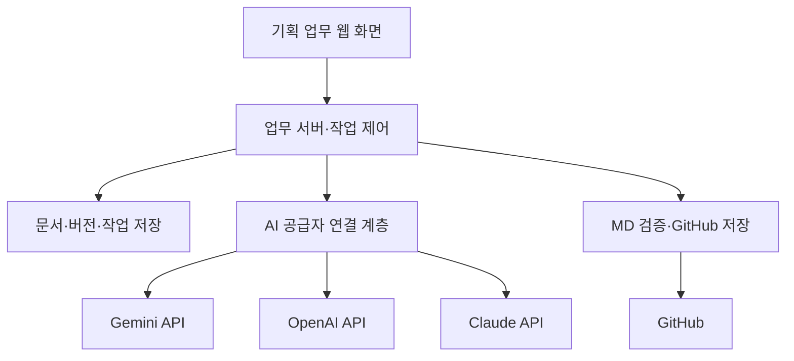

# AI 웹기획 업무 도구 구조 설계

- 문서 버전: v0.1
- 작성일: 2026-09-30
- 상태: 구조 설계안 / 구현 전
- 저장소: redchip-dev/portfolio
- 현재 작업 범위: Markdown 설계 문서 작성 및 저장
- 대상: 웹·모바일 서비스와 SI 관리자 시스템을 기획하는 기획자

## 1. 목표와 설계 원칙

Gemini, ChatGPT, Claude를 활용하여 요구사항 정리부터 정책 설계, 화면 구성, 논리 검토, 개발 전달까지 이어지는 개인용 웹기획 업무 공간을 만든다.

목표는 세 AI가 각각 별도의 기획안을 만드는 것이 아니라, 하나의 프로젝트에 저장된 동일한 요구사항·용어·확정 정책을 기준으로 초안을 작성하고 검토하는 것이다. 역할 분담은 제품 간 절대적인 성능 우열이 아니라 초기 운영을 위한 설계 선택이며, 실제 결과 평가에 따라 변경한다.

1. 기획자가 최종 의사결정을 한다.
2. 요구사항, 근거, 가정, 제안, 확정 정책을 구분한다.
3. AI 제안은 기획자의 채택 전까지 확정 정책을 변경하지 않는다.
4. 결과마다 입력 문서와 정책의 버전을 기록한다.
5. 변경된 부분과 영향을 받는 산출물만 다시 검토한다.
6. 초기에는 수동으로 운영하고, 반복 업무를 확인한 뒤 API 연동을 추가한다.
7. 현재 GitHub에는 MD 문서만 저장한다. 앱 코드, API 키 발급, 클라우드 배포는 이번 작업에 포함하지 않는다.

## 2. 사용 방식과 API 연동 구분

| 구분 | 수동 협업 방식 | 자동화 방식 |
|---|---|---|
| 이용 경로 | 각 AI의 웹 서비스 | 업무 도구의 서버에서 각 공급자 API 호출 |
| 입력 | 공통 업무 패킷을 복사해 전달 | 승인된 문서 버전을 서버가 전달 |
| 결과 수집 | 기획자가 결과를 붙여 넣음 | 서버가 응답을 저장 |
| 현재 유료 구독 활용 | 이용 중인 웹 서비스 범위에서 활용 | 일반 API 연동은 별도 계정·인증·사용량 예산 확인 |
| 시작 조건 | 문서 템플릿과 업무 규칙 | 인증, API 접근, 예산, 데이터 전송 정책 |
| 권장 순서 | 1단계 | 2단계 |

현재 보유한 ChatGPT 유료 구독을 자동화 API 예산으로 간주하지 않는다. 이 설계는 일반적인 서버 API 연동을 기준으로 별도 API 사용량 예산을 둔다. 공급자의 구독 연동 상품이나 인증 방식은 도입 시 최신 조건과 계정별 접근 가능 여부를 다시 확인한다.

Google Cloud는 업무 도구를 운영하는 인프라 후보이다. Google Cloud 가입만으로 세 AI의 API 접근 권한이나 결제가 모두 준비되는 것은 아니다. Google Cloud 크레딧이 OpenAI·Anthropic 직접 API 요금까지 대신 결제한다고 가정하지 않는다.

## 3. AI별 업무 역할

| 역할 | 초기 담당 | 입력 | 출력 |
|---|---|---|---|
| 자료 조사 | Gemini | 조사 질문, 허용 자료, 확정 용어 | 참고 자료, 출처, 근거 요약, 미확인 사항 |
| 기획 초안 | ChatGPT / 자동화 시 OpenAI 모델 | 요구사항, 확정 정책, 조사 결과 | 정책 초안, IA, 화면 항목, 동작 정의 |
| 논리 검토 | Claude | 동일한 업무 패킷과 초안 | 누락, 정책 충돌, 예외, 개선 제안 |
| 최종 통합 | ChatGPT 보조 + 기획자 확정 | 초안, 검토 의견, 채택·보류 결정 | 최종 문서, 결정 기록, 개발 전달 사항 |

- 모든 작업에 세 AI를 호출하지 않는다.
- 조사할 내용이 없으면 조사 단계를 생략한다.
- 단순 문구 수정은 하나의 AI로 처리한다.
- 외부 조사는 출처 접근이 가능한 기능을 명시적으로 사용할 때만 실행한다. 일반 텍스트 생성만으로 최신 자료를 조사했다고 처리하지 않는다.
- 프로토타입 코드는 후속 기능 후보이며 현재 MD 전용 저장 범위에서 제외한다.

## 4. 업무 흐름

| 단계 | 기획자 작업 | AI 지원 | 완료 조건 |
|---|---|---|---|
| 1. 업무 등록 | 목적, 사용자, 범위 입력 | 정보 정리와 질문 제안 | 범위와 미확정 사항 분리 |
| 2. 요구사항 정리 | 원문·자료 등록 | 중복 제거와 항목 분해 | 요구사항 ID 부여 |
| 3. 근거 조사 | 조사 범위 선택 | 출처 기반 참고 자료 정리 | 확인된 사실과 추론 구분 |
| 4. 정책 설계 | 업무 규칙 선택 | 조건·상태·권한·예외 정리 | 미확정 정책 표시 |
| 5. 화면 정의 | 화면 단위 선택 | 항목·버튼·동작 구성 | 요구사항 및 정책과 연결 |
| 6. 논리 검토 | 검토 실행 | 누락·충돌·예외 지적 | 영향 ID와 개선안 제시 |
| 7. 의견 처리 | 채택·보류·반려 | 수정 초안 작성 | 미처리 의견과 차단 이슈 확인 |
| 8. 확정 | 문서 내용 확정 | 표현과 구조 정리 | 확정 버전 생성 |
| 9. GitHub 저장 | 저장 대상과 차이 확인 | MD 생성 지원 | 커밋 SHA와 저장 경로 확인 |

정책 변경 시 이미 확정된 문서는 유지하고 새로운 버전을 만든다. 기존 문서에는 재검토 필요 표시를 붙이며, 새 정책을 기존 확정본에 조용히 덮어쓰지 않는다.

## 5. 화면과 메뉴 구조

### 5.1 초기 메뉴

| 메뉴 | 목적 | 주요 정보 |
|---|---|---|
| 프로젝트 | 프로젝트 선택 및 범위 관리 | 목적, 대상, 현재 단계 |
| 기획 작업 | 요구사항·정책·화면 작업 | 공통 자료, 작성 결과 |
| 검토·확정 | 검토 의견 처리와 문서 확정 | 오류, 의견, 결정 기록 |
| 문서·저장 | 최종 MD 확인과 GitHub 저장 | 버전, 차이, 저장 상태 |
| 설정 | AI 연동 및 운영 설정 | 공급자, 모델, 예산, 저장 경로 |

### 5.2 기획 작업 화면

복잡한 다중 패널 대신 아래 구성으로 시작한다.

- 상단: 프로젝트 / 작업명 / 문서 상태 / 기준 버전
- 왼쪽 좁은 영역: 요구사항 → 정책 → 화면 정의 → 검토 단계 선택
- 중앙: 현재 단계의 문서 편집 영역
- 오른쪽: 검토 실행 후에만 열리는 의견 패널
- 하단 또는 상단 고정 액션: 임시 저장 / AI 초안 작성 / 검토 요청
- GitHub 저장은 문서·저장 메뉴에서 차이 확인 후 실행

요구사항과 문서 상세를 동시에 여러 개 열지 않는다. 화면 정의는 목록에서 하나를 선택하고 상세를 편집하는 구조로 구성한다.

### 5.3 최소 기능

1. 프로젝트와 작업 등록
2. 공통 업무 패킷 생성
3. AI 요청문 복사 및 결과 붙여 넣기
4. 요구사항·정책·화면 정의 편집
5. 검토 의견 채택·보류·반려
6. 확정 문서 버전 생성
7. MD 내보내기
8. GitHub 저장 결과 확인

최초 수동 단계에서는 GitHub 웹 편집이나 현재 연결된 GitHub 도구로 저장할 수 있다. 업무 도구 자체의 GitHub 연동은 자동화 단계에서 구현한다.

## 6. 자동화 단계의 시스템 구성

다음은 구현 예정 구성이다. 현재 클라우드 리소스를 생성한 상태가 아니다.

### 6.1 기술 구성안

| 구성 | 초기 후보 | 역할 |
|---|---|---|
| 웹 화면 | Vue + TypeScript | 단계별 문서 작성과 검토 의견 처리 |
| 업무 서버 | Node.js + TypeScript | 인증, 입력 검증, 공급자 호출, 버전 관리 |
| 서버 운영 | Google Cloud Run | 웹 화면과 서버 운영 |
| 업무 데이터 | Firestore | 프로젝트, 문서 버전, 실행·검토 기록 |
| 비밀정보 | Secret Manager | AI API 키와 GitHub 연동 비밀정보 |
| GitHub | 현재 저장소의 docs 하위 | 검토를 마친 공개 가능한 MD 저장 |

초기에는 프런트엔드와 업무 API를 한 서비스로 운영한다. AI 공급자별 서버를 따로 만들지 않고 연결 계층으로 분리한다. 긴 작업·동시 사용이 실제로 필요해지면 작업 큐와 별도 워커를 추가한다. MVP에는 벡터 DB, 다중 에이전트 프레임워크, 복잡한 검색 인프라를 넣지 않는다.

Google 로그인은 사용자 식별 후보로 두되, 서버가 토큰과 프로젝트 접근 권한을 검증해야 한다. 인증 방식, 사용 지역, 모델, 실제 비용은 구현 전 확정한다.

### 6.2 API 연결 원칙

| 공급자 | 기본 연결 후보 | 관리 원칙 |
|---|---|---|
| OpenAI | Responses API | 웹 서비스 계정과 API 운영 설정 구분 |
| Google | Gemini API | Vertex AI 도입 여부는 별도 판단 |
| Anthropic | Claude Messages API | API 접근 및 키 설정 확인 |

모델명과 단가를 문서의 고정값으로 두지 않는다. 공급자·모델·출력 한도는 설정에서 관리한다. Gemini API와 Vertex AI를 같은 인증·결제 경로로 취급하지 않는다.

서버가 공통 응답 형식으로 변환하고 검증한다. 각 모델이 동일한 구조의 출력을 반드시 보장한다고 가정하지 않는다.

## 7. 공통 업무 패킷

AI에 전달하는 입력은 매번 동일한 구조로 만든다.

| 항목 | 내용 |
|---|---|
| 프로젝트 | 목적, 사용자, 범위 |
| 현재 작업 | 요구사항 정리 / 정책 / 화면 / 검토 |
| 기준 버전 | 입력 문서 버전, 확정 정책 버전 |
| 확정 정보 | 승인된 요구사항, 정책, 용어 |
| 원문·근거 | 참조 자료 ID, 출처, 확인일 |
| 미확정 정보 | 질문, 가정, 판단 대기 항목 |
| 제약 | PC·모바일, 개발 범위, 운영 제약 |
| 요청 출력 | 문서 유형, 표 형식, 검토 기준 |

모든 대화 이력을 세 AI에 전부 전달하지 않는다. 현재 작업에 필요한 부분만 전달하고 제외한 자료를 기록한다. 두 AI 사이의 대화가 자동으로 공유된다고 가정하지 않는다.

## 8. 데이터 및 ID 구조

### 8.1 기본 데이터

| 데이터 | 핵심 필드 |
|---|---|
| 프로젝트 | project_id, 제목, 목적, 소유자, 범위 |
| 요구사항 | requirement_id, 내용, 출처, 상태, 버전 |
| 정책 | policy_id, 조건, 규칙, 예외, 상태, 연결 요구사항 |
| 화면 | screen_id, 목적, 항목, 동작, 연결 정책 |
| 문서 버전 | document_id, version, 내용, 기준 정책 버전, 확정자 |
| AI 실행 | run_id, 공급자, 모델, 입력 버전, 프롬프트 버전, 상태, 사용량 |
| 검토 의견 | review_id, 대상 ID, 심각도, 설명, 제안, 처리 상태 |
| 결정 | decision_id, 채택·보류·반려, 사유, 결정자, 반영 버전 |
| 저장 기록 | export_id, 저장 경로, 문서 버전, commit_sha, 상태 |

프로젝트 소유권은 서버에서 모든 조회·수정·AI 호출·저장 요청에 적용한다.

### 8.2 ID 규칙 예시

| 대상 | 예시 |
|---|---|
| 프로젝트 | PRJ-001 |
| 요구사항 | REQ-001 |
| 정책 | POL-001 |
| 화면 | SCR-001 |
| 검토 의견 | REV-001 |
| 결정 | DEC-001 |
| AI 실행 | RUN-001 |

ID는 생성 후 유지하며 번호를 다시 매기지 않는다. 프로젝트 내 ID를 사용한다면 참조에는 project_id를 함께 저장한다.

요구사항 → 정책 → 화면 → 검토 의견 → 결정의 연결을 유지한다. 어떤 정책 변경이 어떤 화면에 영향을 주는지 조회할 수 있어야 한다.

## 9. 상태와 오류 처리

### 9.1 문서 상태

작성 중 → 검토 중 → 확정

- 검토 의견이 남아 있으면 작성 중으로 돌아가 수정할 수 있다.
- 확정은 기획자만 수행한다.
- 차단 수준 검토 의견은 해결 전 확정을 막는다.
- 보류 의견이 있으면 확정 시 사유를 기록한다.
- 정책 기준 버전이 바뀌면 재검토 필요를 표시한다.

### 9.2 AI 실행 상태

대기 → 실행 중 → 성공 / 실패 / 취소

- 실행 시작 때 입력 버전을 고정한다.
- 실행 중 사용자가 문서를 수정하면 결과를 새 버전 후보로 제시한다.
- 오래된 입력으로 만든 결과가 최신 편집 내용을 덮어쓰지 않는다.
- 타임아웃·일시적 오류는 제한된 횟수만 재시도한다.
- 인증·예산·권한 오류는 자동 재시도하지 않는다.
- 공급자 실패 시 다른 공급자로 몰래 전송하지 않고 기획자가 대체 여부를 선택한다.
- 출력 형식 검증에 실패하면 오류를 표시하며 확정 문서로 처리하지 않는다.
- 중복 실행 및 중복 GitHub 저장 방지를 위한 요청 ID를 둔다.
- 취소 또는 타임아웃이 공급자의 이미 실행된 요청·비용까지 취소한다고 보장하지 않는다.

## 10. 검토 기준과 결과 형식

| 검토 영역 | 확인 사항 |
|---|---|
| 범위 | 요구사항과 화면 목적 일치 |
| 상태 | 생성·수정·중지·완료 상태별 동작 |
| 권한 | 조회·편집·승인 가능 주체 |
| 업무 정책 | 지급·한도·조건·시점의 일관성 |
| 예외 | 대상 없음, 중복, 실패, 재처리 |
| 데이터 | 항목 출처와 참조 관계 |
| 화면 | 필수·읽기 전용·오류·빈 상태 |
| 이력 | 변경 및 승인 이력 연결 |
| 확장 | 항목·유형 추가 시 구조 유지 |

검토 의견은 “대상 ID / 심각도 / 문제 / 근거 / 영향 / 수정 제안 / 처리 상태”로 작성한다. 출처 없는 지적은 추론 또는 확인 필요로 표시한다. AI 여러 개가 동의해도 업무 정책이 자동 확정되지는 않는다.

## 11. GitHub MD 저장 구조와 공개 범위

현재 redchip-dev/portfolio는 공개 저장소이다. 이번 문서는 일반적인 구조 설계만 포함한다. 실제 고객 요구사항, 사내 정책, 개인정보, API 키는 이 공개 저장소에 저장하지 않는다. 비공개 업무 문서를 운영하려면 승인된 비공개 저장소를 별도로 지정한다.

다음은 후속 문서의 제안 경로이며, 이번 작업에서 모든 파일을 생성하는 것은 아니다.

| 경로 | 목적 |
|---|---|
| docs/ai-planning-workbench-architecture.md | 이번 구조 설계 문서 |
| docs/ai-planning/templates/work-package.md | 공통 업무 패킷 |
| docs/ai-planning/templates/requirements.md | 요구사항 |
| docs/ai-planning/templates/policies.md | 정책 정의 |
| docs/ai-planning/templates/screen-spec.md | 화면 정의 |
| docs/ai-planning/templates/review.md | 검토 의견 |
| docs/ai-planning/prompts/research.md | 조사 요청문 |
| docs/ai-planning/prompts/planning.md | 기획 요청문 |
| docs/ai-planning/prompts/review.md | 검토 요청문 |
| docs/ai-planning/decisions.md | 결정 기록 |

### 저장 정책

- GitHub 산출물은 .md 확장자만 허용한다.
- 애플리케이션 실행 기록과 미확정 원본은 업무 저장소에서 관리한다.
- 저장 전에 문서 버전, 대상 경로, 공개 가능 여부, 변경 차이를 표시한다.
- 기존 파일을 갱신할 때 현재 SHA를 확인하고 충돌 시 재검토한다.
- AI가 임의로 브랜치·경로를 바꾸거나 다른 파일을 삭제하지 못한다.
- 최종 문서가 같으면 불필요한 커밋을 만들지 않는다.
- 성공 시 커밋 SHA와 문서 링크를 기록한다.
- 확정 상태와 GitHub 저장 완료 상태를 따로 표시한다.
- 실사용 연동은 특정 저장소·경로에 제한된 권한을 사용한다.

## 12. 비용과 데이터 운영

- API 키와 GitHub 비밀정보를 브라우저, MD, 로그에 넣지 않는다.
- AI 호출 전 전달 대상 자료와 공급자를 표시한다.
- 외부 자료의 지시는 업무 명령으로 실행하지 않는다.
- 일·월 API 예산, 호출 횟수, 출력 한도를 둔다. 초기 금액은 미정이다.
- 비용 추정에 공급자·모델·입출력 사용량·단가 적용일을 기록한다.
- 예산 통제는 앱 수준 차단과 공급자 설정을 함께 사용한다. 클라우드 예산 알림을 강제 지출 상한으로 간주하지 않는다.
- 초과 실행을 막기 위해 동시 요청 비용을 예약하고 실행 후 정산한다.
- 로그에는 원문 대신 실행 ID·상태·사용량을 우선 기록한다.
- 실제 사내 자료 전송은 조직의 허용 범위와 공급자의 데이터 처리 조건 확인 후 적용한다.
- 보관 기간, 삭제 범위, 백업 복구 기준은 구현 전 결정한다.

## 13. 단계별 구축 범위

| 단계 | 결과 | 제외 |
|---|---|---|
| 0. 구조 설계 | 이 MD 문서 | API 호출·앱 구현·배포 |
| 1. 수동 협업 검증 | 업무 패킷, 템플릿, 요청문, 샘플 기획 | 자동 API 호출 |
| 2. 개인용 MVP | 문서 편집, 검토·확정, 버전 관리 | 조직 관리자·복잡한 결재 |
| 3. 선택적 API 연동 | 선택한 단계만 AI 자동 실행 | 무한 반복·자동 정책 확정 |
| 4. GitHub 연동 | 확정 MD 차이 확인·저장 | 고객 원본 공개 저장 |
| 5. 운영 개선 | 비용·품질·실패 처리 측정 | 검증되지 않은 기능 확대 |

자동화는 초안 작성부터 검증하고, 이후 검토와 조사 기능을 순서대로 연결한다. 초기 검토는 각 AI 웹 서비스에서 수동으로 진행해도 된다.

## 14. 리워드 지급 기획 적용 예시

아래는 구조 검증을 위한 가상 업무 예시이며 실제 고객 정책 확정본이 아니다.

| 구분 | 예시 |
|---|---|
| 요구사항 | REQ-001: 미션 완료 대상의 리워드 지급 처리 |
| 정책 초안 | POL-001: 지급 전 유효 대상·지급 한도·중복 여부 확인 |
| 화면 | SCR-001: 대상 목록, 산출 결과, 지급 상태, 오류 사유 |
| 검토 | REV-001: 산출 시 한도와 지급 직전 한도가 달라질 수 있음 |
| 결정 | DEC-001: 한도 재검증 시점과 동시 처리 정책을 확인 필요로 등록 |
| 확정 조건 | 한도 단위, 중복 기준, 실패·재처리 정책 확인 |
| 산출물 | 요구사항·정책·화면·결정이 연결된 MD |

AI는 누락 가능성을 제안하고, 기획자는 업무 담당자와 정책을 확인한다. 미확정 사항을 임의의 값으로 채워 완성된 설계처럼 저장하지 않는다.

## 15. 검증 및 완료 기준

1. 동일한 업무 패킷으로 초안과 검토가 수행되는지 확인한다.
2. 검토 의견의 채택이 결정 기록과 새 문서 버전에 반영되는지 확인한다.
3. 기준 정책 변경 시 연결 화면에 재검토 표시가 생기는지 확인한다.
4. AI 실패·타임아웃에도 편집한 문서가 보존되는지 확인한다.
5. API 키와 민감정보가 MD 내보내기에 포함되지 않는지 확인한다.
6. 확정 MD만 지정 경로에 저장되고 커밋 결과를 확인할 수 있는지 확인한다.
7. 동시에 문서가 변경되면 덮어쓰기 대신 충돌이 표시되는지 확인한다.
8. 한 업무를 끝내는 시간, 누락 발견 수, 재작업 수, API 비용으로 효과를 평가한다.

## 16. 구현 전 결정할 사항

- 최초 검증할 업무와 프로젝트 범위
- 개인 전용 또는 팀 사용 여부
- 허용되는 자료 및 외부 AI 전송 범위
- 공급자별 API 계정·모델·사용량 한도
- 일·월 비용 상한과 알림 기준
- 비공개 업무 문서 저장소
- 인증 방식, 운영 지역, 데이터 보관·삭제 기준

이 문서의 기술 구성과 역할 분담은 제안이다. 계정별 권한·비용·가용 모델을 확인한 뒤 구현 설정을 확정한다.

## 17. 공식 참고 자료

확인일: 2026-09-30. 특정 모델명과 가격은 변경될 수 있으므로 고정하지 않았다.

- [OpenAI API 시작하기](https://developers.openai.com/api/docs/quickstart): API 인증 및 Responses API 연결 기준
- [OpenAI API 가격](https://developers.openai.com/api/docs/pricing): 별도 API 사용량 예산 산정 근거
- [Gemini API 시작하기](https://ai.google.dev/gemini-api/docs/get-started): Google AI API 연결 기준
- [Claude API 개요](https://platform.claude.com/docs/en/api/overview): Messages API 연결 기준
- [Cloud Run 개요](https://docs.cloud.google.com/run/docs/overview/what-is-cloud-run): 서버 운영 후보
- [Firestore](https://cloud.google.com/products/firestore): 문서형 데이터 저장 후보
- [Secret Manager 개요](https://docs.cloud.google.com/secret-manager/docs/overview): 비밀정보 관리 후보
